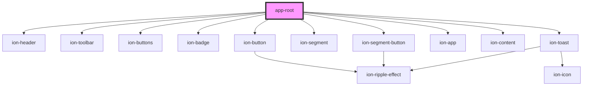

# app-root

<!-- Auto Generated Below -->

## Dependencies

### Depends on

- ion-header
- ion-toolbar
- ion-buttons
- ion-badge
- ion-button
- ion-segment
- ion-segment-button
- ion-app
- ion-content
- ion-toast

### Graph

----------------------------------------------

*Built with [StencilJS](https://stenciljs.com/)*
